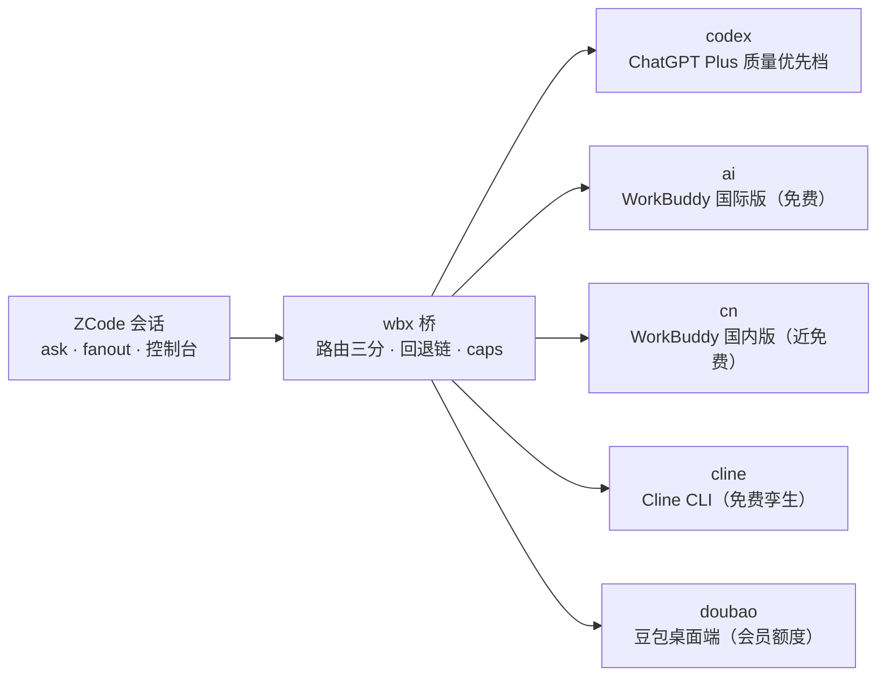

<div align="center">

# wbx 桥

让 AI 编程助手把调研、翻译乃至代码模块编写并行外包给外部算力——五条外部 AI 通道，当作 ZCode 的子代理高频调用。

[](LICENSE)  

当前版本见 [CHANGELOG.md](CHANGELOG.md) 首条。

**目录**：[这是什么](#这是什么) · [快速开始](#快速开始) · [核心命令](#核心命令) · [遇到问题](#遇到问题) · [安全与卸载](#安全与卸载) · [更多文档](#更多文档)

</div>

> [!IMPORTANT]
> 三个诚实声明，先说在前面：① 这是**个人非官方工具**，与 WorkBuddy、腾讯、智谱、Cline 均无关联；② 目前仅支持 **Windows**；③ 这是**临时工具**——它依附的免费策略随时可能变化，不再划算就卸载（见 [UNINSTALL.md](UNINSTALL.md)），不要恋战。


## 这是什么

wbx 是本地命令行桥：把一次提问或一批任务按既定策略分派给**五条外部 AI 通道**（当作 ZCode 的子代理高频调用）——**codex**=Codex CLI（ChatGPT Plus 质量优先档，单发默认优先、额度耗尽自动让位）；**ai**=WorkBuddy 国际版（免费）；**cn**=国内版（近免费）；**cline**=Cline CLI（免费孪生）；**doubao**=豆包桌面端（会员额度）。免费与近免费 lane 底座为 DeepSeek V4.1 Flash。



**适合谁**：Windows + ZCode 用户；把**自包含**的任务（输入可打包、输出可校验）——调研、翻译、抽取、代码模块——并行外包给多路外部算力：免费 lane 放开用，付费两档按路由规则消耗。

### 特性亮点

- **路由自动化**：单发质量档优先、批量免费池、回退链与额度冷却自动让位——全程托管，语义见下方「两个常见澄清」。
- **能力分级（caps）**：缺省纯文本零回退，可选联网只读白名单（带来源清单），越权声明即报错——绝不静默降档。
- **本地控制台**：网页端四页签（状态/调用/历史/登录），浅深双主题，PWA 可安装，五通道状态一目了然。
- **装得上退得净**：桥本体纯 Node ESM 零第三方依赖；`self-uninstall` 一键还原，安装物全部登记可查。

### cn lane 夜间免费档（v24）

每日 23:00–08:00（北京时间）cn 通道免费窗内自动切混元 Hy4 preview、窗外自动回落 DeepSeek V4.1 Flash——本条为**官方免费活动的转述，随活动截止（现口径 2026-10-31）自动回落，一切以官方公告为准**。

### 两个常见澄清（定义拆开说，避免混淆）：

- **「codex 优先」指单发路由**：`wbx ask` 缺省 auto=codex 就绪即投（质量档优先）；codex 未就绪或失败时按 ai→cn→cline→doubao 顺序让位。
- **「回退链」是通道级兜底**：cn→ai→cline→codex→doubao 各一次——任何 lane 失败都按此链找下一个可用 lane（免费优先、付费两档排后）。fanout 批量的缺省池=免费+会员档（不含 codex，任务级点名才投）——批量不自动烧 Plus 额度。

### worker 能力（caps 能力矩阵，v19）

| 能力集 | 含义 | 可用范围 |
|---|---|---|
| 缺省 ∅（L0） | 纯文本零回退 | 五 lane 通用 |
| `--caps "net,read"`（别名 L1） | 联网+只读：WebSearch/WebFetch/Read/Glob/Grep 白名单 + scratch 读边界 + 工具轨迹落盘——时效性调研走这一档并带来源清单 | 仅 ai/cn |
| 写文件 / 执行命令 | 本版未交付：声明即明确报错，绝不静默降档 | — |

## 快速开始

前置：Windows + Node ≥18.20.8 + ZCode；WorkBuddy 桌面版至少成功启动过一次（生成登录模板缓存）。

```bat
:: 1) 获取仓库并进入目录（首次使用）
git clone https://github.com/Oiawlm/zcode-wbx-bridge.git
cd zcode-wbx-bridge

:: 2) 在本仓库目录：全局安装（唯一技能目录 ~/.zcode/skills/wb-bridge/ + AGENTS 块 + ~/.wbx/）
node .zcode\skills\wb-bridge\scripts\wbx.mjs self-install

:: 3) 登录（国内版微信扫码；各一次，凭证约 55 天）
node "%USERPROFILE%\.zcode\skills\wb-bridge\scripts\wbx.mjs" login --identity cn
node "%USERPROFILE%\.zcode\skills\wb-bridge\scripts\wbx.mjs" login --identity ai
::    可选 lane：cline 加 login --identity cline（浏览器 OAuth）；codex 加 login --identity codex
::    （一次性只读复制 ~/.codex/auth.json 入隔离目录）；doubao 在豆包客户端内自理、无需登录

:: 4) 自检（快检 <10s；全量含模型探测排障用）
node "%USERPROFILE%\.zcode\skills\wb-bridge\scripts\wbx.mjs" doctor --quick
```

装完即用：任何项目的 ZCode 会话直接说「帮我调研 A、B、C」就会自动分派，也可显式调用 `/wb-bridge` 技能（`/wbx` 斜杠命令已于 v28 退役）。（self-install 已把 wbx 调用块写入用户级 `~/.zcode/AGENTS.md`，故任何项目皆可；检测到 v28 前旧布局会自动迁移；卸载时随 `self-uninstall` 一并清除。）

## 核心命令

| 命令 | 用途 |
|---|---|
| `wbx ask --file p.txt` | 单发（stdout=结果；`--as codex\|ai\|cn\|cline\|doubao` 点名；`--caps "net,read"` 联网只读） |
| `wbx fanout --file tasks.json` | 批量并行（任务可用 `files:[路径]` 拼材料、`"as":"codex"` 点名；结果落 `<运行时根>/jobs/<jobId>/`（默认 `~/.wbx/`；未跑 self-install 时为项目 `.wbx/`）） |
| `wbx doctor [--quick]` | 自检（`--quick` 秒级快检；全量含各 lane 模型探测） |
| `wbx ui --detach` | 本地控制台 http://127.0.0.1:7788（状态/调用/历史/登录四页签，浅深双主题） |

（`wbx` = `node "%USERPROFILE%\.zcode\skills\wb-bridge\scripts\wbx.mjs"`；全部命令与旗标见 `wbx --help`。单发也可 `wbx ask --text "任务描述"` 直接传；冒烟与连通性验证一律加 `--ephemeral`——真实执行但零落盘、不入历史。）

批量任务文件最小示例（`tasks.json`；完整字段见仓库 `examples/tasks.example.json`）：

```json
[
  { "id": "survey-x", "prompt": "调研 X 并输出要点清单", "files": ["notes/x.md"] },
  { "id": "polish-y", "as": "codex", "prompt": "按给定契约润色模块 Y" },
  { "id": "research-z", "prompt": "核实 Z 的最新版本与变更", "caps": "net,read" }
]
```

三条分别演示：默认投免费池（可 `files` 拼材料）、`"as":"codex"` 任务级点名质量档、`caps` 声明联网只读档（仅 ai/cn 承载，产出带来源清单）。

## 遇到问题？

先跑 `wbx doctor --quick`（秒级零额度）定位症状；常见对号入座：

| 症状 | 处理 |
|---|---|
| doctor 全红 / 凭证过期（401） | 重新 `wbx login`（对应 identity；WorkBuddy 凭证约 55 天） |
| 「cli」红（WorkBuddy 升级后） | 重跑 `wbx doctor` 自动扫描写回，或 `config set cli-path "<新路径>"` |
| cline 报 Daily free model limit | 当日免费额度用尽：等重置或 `wbx models --as cline --free` 换免费模型 |
| cline 报 model not found | 免费组轮换下线：auto-heal（默认开）自动切换；手动换 `cline-model` |
| codex 报额度耗尽 | 自动冷却让位（等冷却或显式点名）；余额看 ChatGPT 网页端 Settings→Usage |
| 豆包 lane 不可用 | 客户端需以调试口 9225 运行：`doubao\launch.ps1`（默认自动拉起） |

完整故障表与机理见 [WBX.md](WBX.md) §7。

## 安全与卸载（一句话版）

- 凭证只存 `<运行时根>`（默认 `~/.wbx/`），绝不入日志/文档/导出包；不写 `~/.workbuddy*`、不读写 `~/.cline`；涉密不外包。
- 一键还原：`wbx self-uninstall [--purge]`；安装物登记表见 [UNINSTALL.md](UNINSTALL.md)。

运行时布局（全部为隔离目录，卸载即净）：

| 路径 | 内容 |
|---|---|
| `~/.wbx/sessions · product · config/` | 各通道凭证与登录模板（安装/登录时生成） |
| `~/.wbx/jobs/<jobId>/` | 每次调度的任务记录与结果（可整目录删除，不影响运行） |
| `~/.wbx/cline-home/`、`~/.wbx/codex-home/` | cline / codex 隔离运行时（HOME/USERPROFILE、CODEX_HOME 覆盖实现隔离；绝不读写用户 `~/.cline`，`~/.codex` 仅一次性只读复制 auth.json 一例） |

## 更多文档

[WBX.md](WBX.md)（技术总文档）· [HISTORY.md](HISTORY.md)（版本史归档）· [UI-SPEC.md](UI-SPEC.md)（控制台设计契约）· [CONTRIBUTING.md](CONTRIBUTING.md)（白名单与提交纪律）· [SECURITY.md](SECURITY.md)（安全问题与上报渠道）

再次强调（三处诚实声明见文首）：本工具**依赖第三方服务与 CLI**（WorkBuddy / DeepSeek / Cline / 豆包 / Codex），其服务条款、免费与定价策略、数据流向以各自官方约定为准——你通过本桥发送的内容会经过这些第三方服务；免费窗口随时可能变化，不再划算时请直接卸载（[UNINSTALL.md](UNINSTALL.md)）。使用本工具产生的任何费用、账号风险由使用者自行承担。
